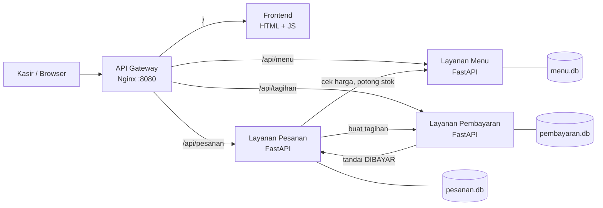

# Kasir Warkop

Sistem kasir untuk warung kopi: pelanggan memesan makanan/minuman, stok berkurang otomatis, tagihan dibuat otomatis, lalu kasir menerima pembayaran dan menghitung kembalian. Dibuat sebagai proyek mata kuliah **Cloud Computing** dengan arsitektur **microservices** yang dijalankan sebagai satu kesatuan memakai Docker Compose, dengan antarmuka **multi-platform (HP, tablet, desktop)** yang dirancang berdasarkan prinsip **HCI/UX**.

## Portofolio desain (HCI/UX dan multi-platform)

| Bagian | Isi | Lokasi |
|---|---|---|
| Riset pengguna | Persona, kebutuhan (MoSCoW), user journey, panduan wawancara | [`docs/01-riset-pengguna.md`](docs/01-riset-pengguna.md) |
| Analisis HCI | 10 heuristik Nielsen dan prinsip ergonomi, dipetakan ke fitur | [`docs/02-analisis-hci.md`](docs/02-analisis-hci.md) |
| Design system | Warna (kontras terukur), tipografi, spasi, komponen | [`docs/03-design-system.md`](docs/03-design-system.md) |
| Strategi multi-platform | Tata letak HP/tablet/desktop, PWA | [`docs/04-multiplatform.md`](docs/04-multiplatform.md) |
| Evaluasi usability | Uji otomatis 43 pemeriksaan, evaluasi heuristik, rencana uji pengguna | [`docs/05-evaluasi-usability.md`](docs/05-evaluasi-usability.md) |
| Bahan presentasi | Alur presentasi sesi Collaborative Learning | [`docs/06-bahan-presentasi.md`](docs/06-bahan-presentasi.md) |
| Wireframe dan design system visual | SVG untuk HP, tablet, desktop | [`design/`](design) |
| Tangkapan layar prototype | HP, tablet, desktop | [`design/screenshots/`](design/screenshots) |
| Prototype frontend | HTML/CSS/JS tanpa framework, bisa dipasang sebagai PWA | [`frontend/`](frontend) |

> Catatan jujur: persona adalah hipotesis, dan uji dengan pengguna nyata belum dilakukan. Lembar uji dan kuesioner SUS sudah disiapkan di `docs/05`.

## Arsitektur



| Layanan | Tugas | Database |
|---|---|---|
| **menu** | Daftar menu, harga, stok | SQLite (`menu.db`) |
| **pesanan** | Membuat/membatalkan pesanan, mengatur status | SQLite (`pesanan.db`) |
| **pembayaran** | Tagihan, pembayaran (tunai/QRIS/transfer), kembalian, laporan harian | SQLite (`pembayaran.db`) |
| **gateway** | Satu pintu masuk, melayani frontend dan meneruskan `/api/*` | - |

Setiap layanan punya database sendiri (prinsip microservices) dan hanya berkomunikasi lewat HTTP/REST.

## Alur terintegrasi

1. Kasir memilih menu dan klik **Buat Pesanan**.
2. **Pesanan** memanggil **Menu** untuk mengambil harga dan memotong stok.
3. **Pesanan** memanggil **Pembayaran** untuk membuat tagihan otomatis.
4. Kasir klik **Bayar**. **Pembayaran** memeriksa uang, menghitung kembalian, lalu memberi tahu **Pesanan** bahwa statusnya menjadi `DIBAYAR`.
5. Setelah minuman/makanan disajikan, kasir klik **Selesai**.
6. Jika pesanan dibatalkan sebelum dibayar, stok dikembalikan dan tagihan ikut dibatalkan.

Status pesanan: `MENUNGGU_PEMBAYARAN` → `DIBAYAR` → `SELESAI` (atau `BATAL`).

Jika salah satu layanan gagal di tengah proses, perubahan sebelumnya dibatalkan (stok dikembalikan), sehingga data tetap konsisten.

## Cara menjalankan

Prasyarat: Docker dan Docker Compose.

```bash
git clone <url-repository-ini>
cd kasir-warkop
docker compose up -d --build
```

Buka **http://localhost:8080**. Untuk mematikan: `docker compose down` (tambahkan `-v` untuk menghapus data).

### Uji otomatis alur pesan-bayar

```bash
python3 scripts/smoke_test.py      # Linux/Mac
python scripts/smoke_test.py       # Windows (PowerShell)
```

Skrip ini membuat pesanan, memeriksa stok, tagihan, pembayaran, pembatalan, dan laporan. GitHub Actions menjalankan pengujian yang sama di setiap push (`.github/workflows/ci.yml`).

## Endpoint API (lewat gateway)

| Method | Path | Fungsi |
|---|---|---|
| GET | `/api/menu` | Daftar menu |
| POST | `/api/menu` | Tambah menu |
| POST | `/api/menu/{id}/stok` | Ubah stok (`{"delta": 10}`) |
| POST | `/api/pesanan` | Buat pesanan |
| GET | `/api/pesanan` | Daftar pesanan |
| PATCH | `/api/pesanan/{id}/status` | Ubah ke `SELESAI` |
| POST | `/api/pesanan/{id}/batal` | Batalkan pesanan |
| GET | `/api/tagihan/{pesanan_id}` | Detail tagihan |
| POST | `/api/tagihan/{pesanan_id}/bayar` | Bayar (`metode`, `jumlah_bayar`) |
| GET | `/api/tagihan/laporan` | Pendapatan hari ini |

Contoh membuat pesanan:

```bash
curl -X POST http://localhost:8080/api/pesanan \
  -H "Content-Type: application/json" \
  -d '{"nama_pelanggan":"Budi","meja":"3","item":[{"menu_id":1,"jumlah":2},{"menu_id":8,"jumlah":1}]}'
```

## Struktur repository

```
kasir-warkop/
├── docs/                  # dokumen HCI/UX (01-06)
├── design/                # wireframe SVG, design system, tangkapan layar
├── frontend/              # prototype: index.html, css/, js/, icons/, manifest.json, sw.js
├── services/
│   ├── menu/              # main.py, Dockerfile, requirements.txt
│   ├── pesanan/
│   └── pembayaran/
├── gateway/nginx.conf     # API gateway + penyaji frontend
├── scripts/
│   ├── smoke_test.py      # uji integrasi backend
│   ├── kontras.py         # pemeriksa kontras warna
│   └── uji_antarmuka/     # uji UI otomatis (Playwright)
├── docker-compose.yml
├── .github/workflows/ci.yml
└── README.md
```

## Deploy ke cloud (contoh: VM AWS EC2 / GCP / Azure)

1. Buat VM Ubuntu dan buka port 80 (atau 8080) di security group/firewall.
2. Pasang Docker, lalu `git clone` repository ini di VM.
3. Jalankan `docker compose up -d --build`.
4. Akses lewat `http://<IP-publik-VM>:8080`.

## Pengembangan lanjutan (opsional)

- Ganti SQLite dengan PostgreSQL per layanan.
- Tambah login kasir (JWT).
- Tambah layanan Laporan atau Notifikasi ke dapur memakai RabbitMQ/Redis.
- Tambah Kubernetes manifest untuk bagian orkestrasi.
