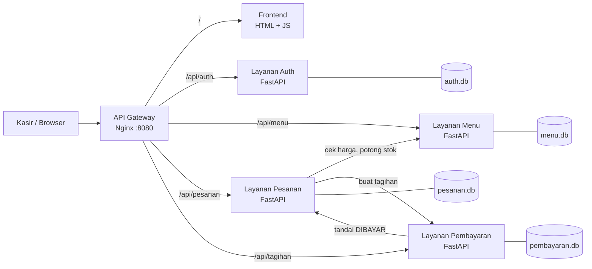

# Kasir Warkop

**Mata kuliah:** Cloud Computing

**Anggota kelompok:**

| No | Nama | NIM |
|---|---|---|
| 1 | Taufiq Hidayatullah | 240602003 |
| 2 | Fachry Maulana W | 240602068 |

Sistem kasir untuk warung kopi: kasir **masuk dengan akun**, memesan makanan/minuman, stok berkurang otomatis, tagihan dibuat otomatis, lalu kasir menerima pembayaran dan menghitung kembalian. Pemilik juga dapat melihat **rekap penjualan harian, mingguan, dan bulanan**. Dibuat sebagai proyek mata kuliah **Cloud Computing** dengan arsitektur **microservices** yang dijalankan sebagai satu kesatuan memakai Docker Compose, dengan antarmuka **multi-platform (HP, tablet, desktop)** yang dirancang berdasarkan prinsip **HCI/UX**.

> **Baru memulai?** Ikuti [`TUTORIAL.md`](TUTORIAL.md) untuk langkah menjalankan dari nol (Windows/PowerShell).

## Portofolio desain (HCI/UX dan multi-platform)

| Bagian | Isi | Lokasi |
|---|---|---|
| Riset pengguna | Persona, kebutuhan (MoSCoW), user journey, panduan wawancara | [`docs/01-riset-pengguna.md`](docs/01-riset-pengguna.md) |
| Analisis HCI | 10 heuristik Nielsen dan prinsip ergonomi, dipetakan ke fitur | [`docs/02-analisis-hci.md`](docs/02-analisis-hci.md) |
| Design system | Warna (kontras terukur), tipografi, spasi, komponen | [`docs/03-design-system.md`](docs/03-design-system.md) |
| Strategi multi-platform | Tata letak HP/tablet/desktop, PWA | [`docs/04-multiplatform.md`](docs/04-multiplatform.md) |
| Evaluasi usability | Uji otomatis 84 pemeriksaan, evaluasi heuristik, rencana uji pengguna | [`docs/05-evaluasi-usability.md`](docs/05-evaluasi-usability.md) |
| Pengembangan lanjutan | Autentikasi (JWT) dan rekap penjualan: rancangan, keputusan, keterbatasan | [`docs/07-pengembangan-lanjutan.md`](docs/07-pengembangan-lanjutan.md) |
| Bahan presentasi | Alur presentasi sesi Collaborative Learning | [`docs/06-bahan-presentasi.md`](docs/06-bahan-presentasi.md) |
| Wireframe dan design system visual | SVG untuk HP, tablet, desktop | [`design/`](design) |
| Tangkapan layar prototype | HP, tablet, desktop | [`design/screenshots/`](design/screenshots) |
| Prototype frontend | HTML/CSS/JS tanpa framework, bisa dipasang sebagai PWA | [`frontend/`](frontend) |

> Catatan jujur: persona adalah hipotesis, dan uji dengan pengguna nyata belum dilakukan. Lembar uji dan kuesioner SUS sudah disiapkan di `docs/05`.

## Arsitektur



Menu, pesanan, dan pembayaran **tidak** bisa dipakai tanpa token: setiap permintaan harus membawa `Authorization: Bearer <token>` dari layanan **auth**. Token JWT ditandatangani dengan rahasia bersama, sehingga tiap layanan memeriksanya sendiri (tanpa menelepon auth di setiap permintaan).

| Layanan | Tugas | Database |
|---|---|---|
| **auth** | Login, token JWT, akun kasir/pemilik (kata sandi di-hash PBKDF2), pembatas percobaan login | SQLite (`auth.db`) |
| **menu** | Daftar menu, harga, stok | SQLite (`menu.db`) |
| **pesanan** | Membuat/membatalkan pesanan, mengatur status | SQLite (`pesanan.db`) |
| **pembayaran** | Tagihan, pembayaran (tunai/QRIS/transfer), kembalian, laporan harian, **rekap harian/mingguan/bulanan** | SQLite (`pembayaran.db`) |
| **gateway** | Satu pintu masuk, melayani frontend dan meneruskan `/api/*` | - |

Panggilan antar-layanan (pesanan -> menu, pesanan -> pembayaran, pembayaran -> pesanan) memakai `X-Service-Key` rahasia yang **dihapus oleh gateway** pada permintaan dari luar, sehingga klien tidak bisa memalsukannya.

Setiap layanan punya database sendiri (prinsip microservices) dan hanya berkomunikasi lewat HTTP/REST.

## Alur terintegrasi

1. Kasir memilih menu dan klik **Buat Pesanan**.
2. **Pesanan** memanggil **Menu** untuk mengambil harga dan memotong stok.
3. **Pesanan** memanggil **Pembayaran** untuk membuat tagihan otomatis.
4. Kasir klik **Bayar**. **Pembayaran** memeriksa uang, menghitung kembalian, lalu memberi tahu **Pesanan** bahwa statusnya menjadi `DIBAYAR`.
5. Setelah minuman/makanan disajikan, kasir klik **Selesai**.
6. Jika pesanan dibatalkan sebelum dibayar, stok dikembalikan dan tagihan ikut dibatalkan.

Status pesanan: `MENUNGGU_PEMBAYARAN` → `DIBAYAR` → `SELESAI` (atau `BATAL`).

Jika salah satu layanan gagal di tengah proses, perubahan sebelumnya dibatalkan (stok dikembalikan), sehingga data tetap konsisten.

## Cara menjalankan

Prasyarat: Docker dan Docker Compose.

```bash
git clone <url-repository-ini>
cd kasir-warkop
docker compose up -d --build
```

Buka **http://localhost:8080** dan masuk dengan akun awal:

| Peran | Nama pengguna | Kata sandi awal | Bisa |
|---|---|---|---|
| Pemilik | `pemilik` | `pemilik123` | Semua, termasuk Rekap penjualan dan tambah menu/akun |
| Kasir | `kasir1` | `kasir123` | Menu, pesanan, pembayaran, laporan hari ini |

> **Hanya untuk demo.** Sebelum dipakai sungguhan, salin `.env.example` menjadi `.env` lalu ganti `JWT_SECRET`, `SERVICE_KEY`, `PEMILIK_PASSWORD`, dan `KASIR_PASSWORD`. Sandi awal hanya dipakai saat database akun masih kosong. Isi `DEMO_DATA=true` di `.env` bila ingin 60 hari data contoh agar Rekap langsung terisi.

Untuk mematikan: `docker compose down` (tambahkan `-v` untuk menghapus data).

### Uji otomatis

```bash
python3 scripts/smoke_test.py      # Linux/Mac
python scripts/smoke_test.py       # Windows (PowerShell)
```

Skrip ini memeriksa login, penolakan tanpa token (401) dan peran salah (403), lalu membuat pesanan, memeriksa stok, tagihan, pembayaran, pembatalan, laporan, dan rekap. Uji tanpa Docker: `python scripts/uji_unit/run_all.py`. GitHub Actions menjalankan pengujian yang sama di setiap push (`.github/workflows/ci.yml`).

## Endpoint API (lewat gateway)

Semua endpoint kecuali `POST /api/auth/login` memerlukan token. **K** = kasir, **P** = pemilik, **L** = hanya antar-layanan.

| Method | Path | Fungsi | Akses |
|---|---|---|---|
| POST | `/api/auth/login` | Masuk, mengembalikan token | publik |
| GET | `/api/auth/me` | Data akun yang sedang masuk | K, P |
| POST | `/api/auth/ganti-sandi` | Ganti kata sandi sendiri | K, P |
| GET / POST | `/api/auth/users` | Daftar / tambah akun | P |
| GET | `/api/menu`, `/api/menu/{id}` | Daftar / detail menu | K, P |
| POST | `/api/menu` | Tambah menu | P |
| POST | `/api/menu/{id}/stok` | Ubah stok (`{"delta": 10}`) | P, L |
| POST | `/api/pesanan` | Buat pesanan | K, P |
| GET | `/api/pesanan`, `/api/pesanan/{id}` | Daftar / detail pesanan | K, P |
| PATCH | `/api/pesanan/{id}/status` | `SELESAI` (pengguna) atau `DIBAYAR` (hanya antar-layanan) | K, P, L |
| POST | `/api/pesanan/{id}/batal` | Batalkan pesanan | K, P |
| GET | `/api/tagihan`, `/api/tagihan/{pesanan_id}` | Daftar / detail tagihan | K, P |
| POST | `/api/tagihan/{pesanan_id}/bayar` | Bayar (`metode`, `jumlah_bayar`) | K, P |
| GET | `/api/tagihan/laporan` | Pendapatan hari ini | K, P |
| GET | `/api/tagihan/rekap?periode=harian\|mingguan\|bulanan&tanggal=YYYY-MM-DD` | **Rekap penjualan periode tertentu** | P |

Rekap berisi total, jumlah transaksi, rata-rata, rincian per jam (harian) atau per tanggal (mingguan/bulanan), rincian per metode bayar, titik tertinggi, dan perbandingan dengan periode sebelumnya. Minggu dihitung Senin-Minggu, zona waktu WIB, hanya tagihan berstatus LUNAS.

Contoh:

```bash
TOKEN=$(curl -s -X POST http://localhost:8080/api/auth/login -H "Content-Type: application/json" \
  -d '{"username":"pemilik","password":"pemilik123"}' | python3 -c "import sys,json;print(json.load(sys.stdin)['access_token'])")
curl -H "Authorization: Bearer $TOKEN" "http://localhost:8080/api/tagihan/rekap?periode=mingguan"
```

Contoh membuat pesanan:

```bash
curl -X POST http://localhost:8080/api/pesanan \
  -H "Authorization: Bearer $TOKEN" -H "Content-Type: application/json" \
  -d '{"nama_pelanggan":"Budi","meja":"3","item":[{"menu_id":1,"jumlah":2},{"menu_id":8,"jumlah":1}]}'
```

## Struktur repository

```
kasir-warkop/
├── docs/                  # dokumen HCI/UX (01-06)
├── design/                # wireframe SVG, design system, tangkapan layar
├── frontend/              # prototype: index.html, css/, js/, icons/, manifest.json, sw.js
├── services/
│   ├── auth/              # login, JWT (auth.py dibagi ke semua layanan), pengguna.py, pembatas.py
│   ├── menu/              # main.py, Dockerfile, requirements.txt
│   ├── pesanan/
│   └── pembayaran/        # + rekap.py (rekap penjualan), contoh_data.py (data demo)
├── gateway/nginx.conf     # API gateway + penyaji frontend
├── scripts/
│   ├── smoke_test.py      # uji integrasi backend (login, 401/403, alur, rekap)
│   ├── uji_unit/          # 59 uji unit tanpa Docker
│   ├── cek_modul_sama.py  # auth.py identik di semua layanan
│   ├── cek_proteksi_route.py  # setiap endpoint punya aturan akses
│   ├── kontras.py         # pemeriksa kontras warna
│   └── uji_antarmuka/     # uji UI otomatis (Playwright)
├── docker-compose.yml
├── .env.example           # rahasia dan sandi awal (salin menjadi .env)
├── .github/workflows/ci.yml
└── README.md
```

## Deploy ke cloud (contoh: VM AWS EC2 / GCP / Azure)

1. Buat VM Ubuntu dan buka port 80 (atau 8080) di security group/firewall.
2. Pasang Docker, lalu `git clone` repository ini di VM.
3. Jalankan `docker compose up -d --build`.
4. Akses lewat `http://<IP-publik-VM>:8080`.

## Keterbatasan yang diketahui

- Token bersifat *stateless*: tombol **Keluar** menghapus token di browser, tetapi token yang sudah bocor tetap sah sampai kedaluwarsa (default 8 jam, `TOKEN_JAM`). Pencabutan token belum ada.
- Token disimpan di `sessionStorage` (hilang saat tab ditutup). Aman dari CSRF, tetapi bisa dicuri bila ada celah XSS; frontend sudah meng-escape semua isi dinamis.
- Pembatas percobaan login ada di memori satu proses (hilang saat restart).
- Lalu lintas lokal memakai HTTP. Di cloud, pasang HTTPS di depan gateway agar token tidak terkirim polos.
- Rekap membaca langsung tabel `tagihan`; untuk data besar perlu agregasi terjadwal.

## Pengembangan lanjutan (opsional)

- Ganti SQLite dengan PostgreSQL per layanan.
- Refresh token dan pencabutan token (daftar cabut di Redis).
- Ekspor rekap ke CSV/PDF.
- Tambah layanan Notifikasi ke dapur memakai RabbitMQ/Redis.
- Tambah Kubernetes manifest untuk bagian orkestrasi.
